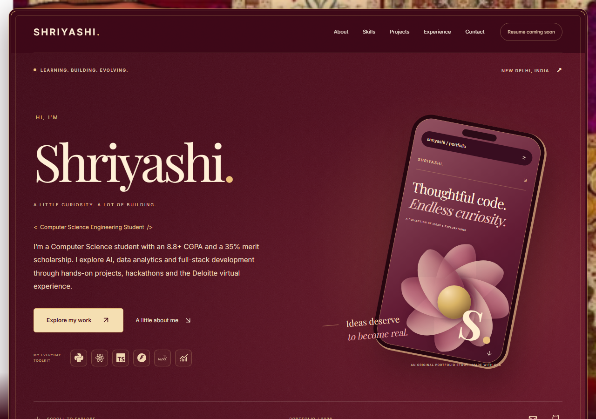

# Shriyashi — Developer Portfolio

A standalone React 18 + TypeScript portfolio for Shriyashi. Source repository: https://github.com/shriyashi2007-lang/shriyashiPORTFOLIO. Originally developed in a separate `portfolio/` folder alongside DevTrack; this repository contains only the portfolio.

The current theme follows the latest textile reference supplied on 26 October: velvet burgundy, antique gold, ivory, and lotus rose. The supplied image frames the page, with an original subtle SVG grain over the interior. Core styles live in `src/styles/theme.css`, and textile-specific decoration in `src/styles/heritage.css`. The hero phone and botanical sculpture are original CSS artwork. This replaces the earlier charcoal/seafoam direction.

Browser contact tests start an isolated second development server with a mock endpoint. They verify configured form validation, loading, success and failure without sending real messages.



## Magical opening

A reference-inspired transparent fairy enters from beyond the **right edge**, travels in broad looping arcs across the **entire viewport toward the left**, and exits beyond the left edge. She remains upright without tilting and is sized to 92% of the viewport height. The shallow vertical flight keeps her tall silhouette in view. Glowing flower petals and sparkling blossoms accompany her, with a short sparkle flourish before the actual portfolio opens through an expanding circular wipe. There is no centred orbit card, forest photograph or separate welcome headline. The full-page transition lasts about 5.9 seconds and is not a network-loading indicator.

Visitors can choose **Skip to portfolio** or press **Escape**. Keyboard focus stays within the welcome while it is open, then returns to the site. Scrolling and background interaction are restored on dismissal. Visitors who prefer reduced motion open the portfolio immediately. Ordinary in-page navigation does not replay the welcome.

The transparent character is `public/assets/fairy/fairy-cutout.png`, generated from the supplied reference with a fully opaque embroidered ivory gown. The original reference is retained separately as `forest-fairy.png` and is not used by the intro. The viewport-scaled Bézier flight path, timing and flowers are in `src/components/ui/FairyWelcome.tsx`; CSS motion-path and circular-mask styling are in `src/styles/fairy-welcome.css`. Run `node scripts/review-fairy.mjs` against the local dev server to capture the desktop/mobile transition and record `artifacts/fairy-cross-screen.webm`.


## Run locally

Requires Node 22.12+ (verified using Node 24).

```sh
npm install
npm run dev
```

Build and preview: `npm run build`, then `npm run preview` (http://127.0.0.1:4173).

## Configuration

Copy `.env.example` to `.env`. The exact GitHub username `shriyashi2007-lang` is already verified from the supplied project links and used by default. `VITE_GITHUB_USERNAME` overrides it. To disable live GitHub integration, set `config.github.username` to an empty string. No network request is made in that case. Vite environment changes require a restart/rebuild.

Identity, education, experience, certificate records, optional social links, SIH 2026 status, phone visibility and academic project descriptions live in `src/data/config.ts`. Never add private GitHub tokens to `VITE_` environment variables; they become public in browser code. Optional GitHub authentication requires a separately secured server proxy.

Set `VITE_CONTACT_ENDPOINT` to your Formspree HTTPS form endpoint, such as the endpoint from your Formspree dashboard. This implementation supports Formspree JSON submissions. The form uses required field validation, a honeypot, a 12-second timeout and real delivery responses. Without an endpoint, it shows an email link and cannot pretend to send a message. Other contact providers require adapting the request to their documented schema.

## Add your assets

No resume PDF, profile image, project screenshots or certificates were present in the supplied attachments. The app deliberately disables missing asset links. Add files, then restart/rebuild so the build-time asset inventory updates.

| Asset                   | Exact path                                        | Configuration                                                                          |
| ----------------------- | ------------------------------------------------- | -------------------------------------------------------------------------------------- |
| Resume PDF              | `public/resume/Shriyashi_Resume.pdf`              | Automatically enables view/download actions                                            |
| Optional portrait       | `public/assets/profile/profile.webp`              | 800×1000 preferred; replaces the monogram automatically                                |
| SIH 2025 certificate    | `public/assets/certificates/sih-2025.pdf`         | Set the matching `config.certifications[].file` to `/assets/certificates/sih-2025.pdf` |
| Arambhathon certificate | `public/assets/certificates/arambhathon-2025.pdf` | Set matching `.file`                                                                   |
| Deloitte certificate    | `public/assets/certificates/deloitte-forage.pdf`  | Set matching `.file`                                                                   |
| SIH 2026 certificate    | `public/assets/certificates/sih-2026.pdf`         | Confirm `config.sih2026.status` and add a certificate record before enabling           |
| Project screenshots     | `public/assets/projects/<exact-repo-name>.webp`   | 1600×1000, preferably ≤250 KB; loaded automatically                                    |
| Social preview          | `public/og.png`                                   | Supplied, 1200×630                                                                     |

`npm run optimize-images` converts PNG/JPEG files under `public/assets` into WebP (max width 1600px). Inspect the resulting sizes before publishing. Only PDFs are supported for certificate viewing in this version; PDFs open in a separate tab. Do not configure image certificates without adding an accessible viewer.

## Curate projects

`src/data/featuredProjects.ts` contains seven unique repositories from the supplied list. The duplicate resume builder link is intentionally included once. Titles, descriptions and tags were checked against repository READMEs where available; see `repository-evidence.json` and `DECISIONS.md`. The four demo URLs were read from repository metadata and returned HTTP 200 during verification. Never add a demo URL without checking it.

Live repositories are filtered and scored by `src/lib/curate.ts`. Up to 12 README checks inform scoring. Six projects show initially, with a show-all button for additional results. Network failures show all seven curated fallback cards; academic projects without verified repository matches appear in an expandable area with no invented links. Missing screenshots use original, explicitly labelled typographic artwork. They are not represented as product screenshots.

## Verify

```sh
npm run lint
npx tsc --noEmit
npm run test
npm run build
npx playwright install chromium
npm run test:e2e
```

Playwright starts the preview server automatically. Screenshots are written to `artifacts/portfolio-{360,768,1280,1920}.png`. `artifacts/verification.md` records the measured results and remaining limitations. Unit tests cover filtering, scoring, caching, timeouts, GitHub errors, asset guards and contact validation. Component tests cover actual configured contact delivery states. Browser tests mock GitHub deterministically.

## Deploy

For Vercel, import `shriyashi2007-lang/shriyashiPORTFOLIO`, use the repository root directory, choose Vite as the framework, `npm run build` and `dist`. Add the environment variables above. `vercel.json` supplies an SPA rewrite and asset caching. Netlify can use the repository root with the supplied `netlify.toml`. If deploying from the original DevTrack workspace instead, select its `portfolio/` subfolder as the root.

No site has been deployed and no live portfolio URL is claimed. After deployment, configure the final absolute Open Graph image URL and canonical URL, recheck external links, and rerun Lighthouse against the real site. Files in `/assets` are cached for one year; rename manually supplied image assets when changing them, or purge the deployment cache.
